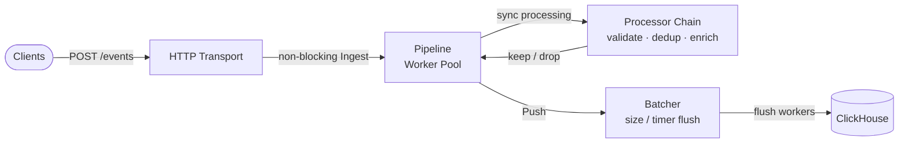

# Hopper

**Hopper** – это in-memory сервис для процессинга и батчевой записи потоковых
аналитических событий в **ClickHouse**.

---

## Проблема

Движок `MergeTree` в ClickHouse оптимизирован под вставку больших пачек данных,
но деградирует при частом `INSERT` одиночных записей

**Hopper** выступает буфферизирующим шлюзом между клиентскими приложениями /
микросерсисами и ClickHouse:

1. Принимает трафик по **HTTP** без блокировки на IO базы данных
2. Отбрасывает дубликаты и обогащает события метаданными
3. Агрегирует поток в крупные пачки и отправляет их в ClickHouse одинм native
TCP-батчем, а при недоступности СУБД – сохраняет пачки в локальный **WAL** на
диске с автоматическим досыланием

## Архитектура



1. HTTP-хендлер кладет событие в буфферизированный канал без блокировки, если
канал полный, возвращает клиенту ошибку `429 Too Many Requests`
2. `Pipeline` упарвляет многопоточной обработкой процессоров, сама логика
обработки событий - цепь из разных процессоров
3. Сброс батчей происходит по двум триггерам: размер батча стал равен целевому
либо сработал таймер и батч не пустой
4. `Batcher` отправляет сформированные батчи в канал `flushCh`, из которого
его воркеры забирают батчи и отправляют из в ClickHouse
5. Гарантия доставки батчей `at-most-once` в случайном порядке при нескольких
воркерах `Batcher`
6. Ступенчатый Graceful Shutdown:
   1. Отключается прием новых HTTP запросов,
   2. `Pipeline` закрывает прием новых событий и дорабатывает полученные,
   3. `Batcher` закрывает прием новых событий, отправляет последний батч и
   ждет отправку батчей.

### Структура проекта

- `internal/event` – стурктура события
- `internal/transport/http/server` – приём событий, парсинг JSON, маппинг
ошибок и формирование ответа
- `internal/pipeline` – входной буффер с воркер-пулом обработчиков процессоров
- `internal/pipeline/processors` – процессоры событий
- `internal/batcher` – накопление батчей и отправка их по размеру или таймеру
- `internal/config` – конфигурация приложения
- `internal/cache` – шардированный кеш

## API и схема данных

TBD

## Тестирование и бенчмарки

Запуск тестов:

```sh
make test 
# или 
# go test -v -race --count=5 ./.. 
# go vet ./...
```

### Покрытие

```
github.com/neelalala/hopper/internal/batcher      coverage: 95.8% of statements
github.com/neelalala/hopper/internal/pipeline     coverage: 97.2% of statements
```

## Состояние проекта

- [Этап 1. Core / v0.1](ROADMAP.md#этап-1-core--v01-ядро-конвейера-многопоточность-работа-с-http-и-clickhouse) Активная разработка
- [Этап 2. Configurable pipeline / v0.2](ROADMAP.md#этап-2-configurable-pipeline--v02-конфигурируемый-пайплайн-и-отказоустойчивость)
- [Этап 3. Lua-scripts / v0.3](ROADMAP.md#этап-3-lua-scripts--v03-поддержка-пользовательских-процессоров-на-lua-из-конфигурации)
- [Этап 4. Dynamic ClickHouse schema / v0.4](ROADMAP.md#этап-4-dynamic-clickhouse-schema--v04-динамическая-схема-и-маппинг-на-таблицу-пользователя)
- [Этап 5. MVP / v1.0](ROADMAP.md#этап-5-mvp--v10-оптимизация-и-observability)
